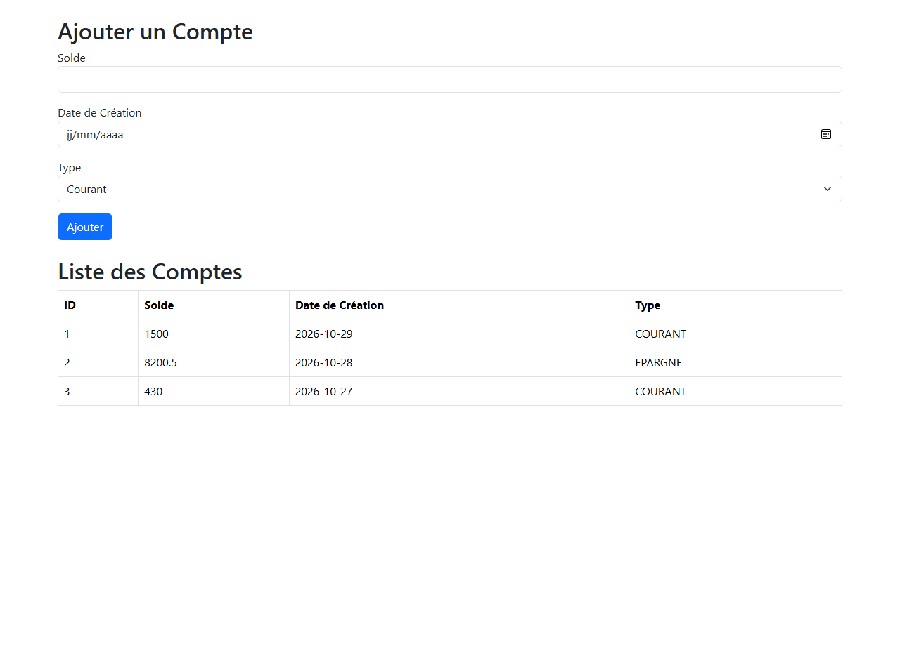
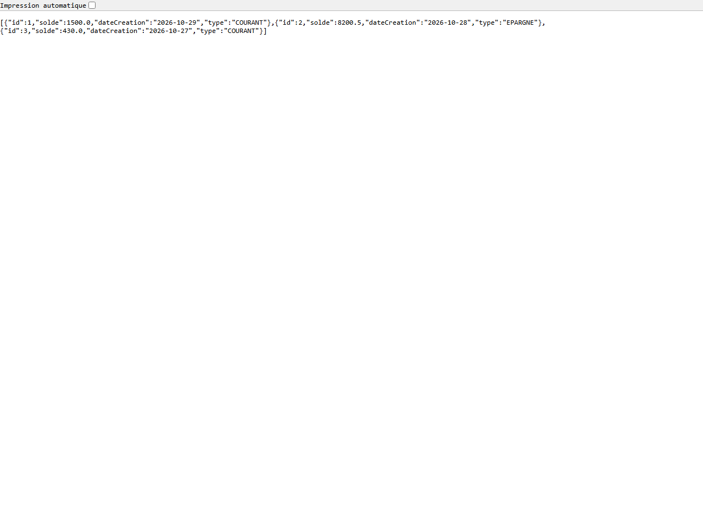

# Client React pour API REST — Gestion des comptes

Application web complète (frontend **React** + backend **Spring Boot**) permettant de **consulter** et **ajouter** des comptes bancaires via une API REST.



---

## Sommaire

- [Aperçu](#aperçu)
- [Architecture](#architecture)
- [Prérequis](#prérequis)
- [Installation](#installation)
- [Démarrage](#démarrage)
- [API REST](#api-rest)
- [Structure du projet](#structure-du-projet)
- [Captures d'écran](#captures-décran)

---

## Aperçu

L'application est composée de deux projets indépendants :

| Partie | Technologie | Port | Rôle |
|---|---|---|---|
| **Frontend** | React + Bootstrap + Axios | `3000` | Interface utilisateur (formulaire + tableau) |
| **Backend** | Spring Boot (API REST) | `8082` | Expose les endpoints `/api/comptes` |

Le frontend consomme l'API via Axios. Après un ajout, la liste des comptes se **rafraîchit automatiquement** (aucun rechargement de page nécessaire).

---

## Architecture

```
┌─────────────────────────┐        HTTP / JSON         ┌──────────────────────────┐
│  React (localhost:3000) │  ───────────────────────▶  │  Spring Boot (:8082)     │
│  - CompteForm           │   GET  /api/comptes        │  - CompteController      │
│  - CompteList           │   POST /api/comptes        │  - Stockage en mémoire   │
└─────────────────────────┘  ◀───────────────────────  └──────────────────────────┘
                                     JSON
```

- **État partagé** : la liste des comptes est détenue par le composant `App` et transmise à `CompteList`. Le formulaire `CompteForm` déclenche un rafraîchissement après un ajout réussi.
- **CORS** : le backend autorise explicitement l'origine `http://localhost:3000`.

---

## Prérequis

| Outil | Version utilisée | Remarque |
|---|---|---|
| Node.js | v24.21.0 | inclut npm |
| npm | 11.19.0 | |
| Java (JDK) | 1.8.0_503 | Java 8 suffit |
| Apache Maven | 3.9.9 | pour compiler le backend |

> **Important** : le backend utilise **Spring Boot 2.7.18**, la dernière version compatible avec **Java 8**.
> Spring Boot 3.x exige Java 17 au minimum.

---

## Installation

### 1. Backend (Spring Boot)

```bash
cd backend-comptes
mvn clean package -DskipTests
```

### 2. Frontend (React)

```bash
cd compte-client
npm install
```

---

## Démarrage

Ouvrez **deux terminaux**.

### Terminal 1 — Backend (port 8082)

```bash
cd backend-comptes
mvn spring-boot:run
```

Ou, après compilation :

```bash
java -jar target/comptes-api-0.0.1-SNAPSHOT.jar
```

### Terminal 2 — Frontend (port 3000)

```bash
cd compte-client
npm start
```

Puis ouvrez **http://localhost:3000**.

> Si le port `8082` est déjà occupé, arrêtez le processus qui l'utilise :
> ```powershell
> Get-NetTCPConnection -LocalPort 8082 -State Listen | ForEach-Object { Stop-Process -Id $_.OwningProcess -Force }
> ```

---

## API REST

### `GET /api/comptes`

Retourne la liste des comptes.

**Réponse**

```json
[
  {
    "id": 1,
    "solde": 1500.0,
    "dateCreation": "2026-10-29",
    "type": "COURANT"
  }
]
```

### `POST /api/comptes`

Ajoute un compte. Un `id` est généré automatiquement.

**Corps de la requête**

```json
{
  "solde": 8200.5,
  "dateCreation": "2026-10-28",
  "type": "EPARGNE"
}
```

Le champ `type` accepte `COURANT` ou `EPARGNE`.

**Exemple de test (PowerShell)**

```powershell
$body = '{"solde":1500,"dateCreation":"2026-10-29","type":"COURANT"}'
Invoke-RestMethod -Uri "http://localhost:8082/api/comptes" `
  -Method Post -ContentType "application/json" -Body $body
```

> **Stockage en mémoire** : les comptes sont perdus à chaque redémarrage du backend (pas de base de données dans cette version minimale).

---

## Structure du projet

```
Client React pour API REST/
├── backend-comptes/                 # API REST Spring Boot
│   ├── pom.xml
│   └── src/main/
│       ├── java/com/example/comptes/
│       │   ├── ComptesApplication.java   # Point d'entrée
│       │   ├── Compte.java               # Modèle
│       │   └── CompteController.java     # Endpoints GET / POST
│       └── resources/application.properties
├── compte-client/                   # Application React
│   ├── package.json
│   └── src/
│       ├── App.js                   # État partagé + rafraîchissement
│       ├── config.js                # URL de base de l'API
│       ├── index.js                 # Import de Bootstrap
│       └── components/
│           ├── CompteForm.js        # Formulaire d'ajout
│           └── CompteList.js        # Tableau des comptes
├── docs/screenshots/                # Captures d'écran
└── README.md
```

---

## Captures d'écran

**1. Formulaire + liste des comptes** (`http://localhost:3000`)


**2. Réponse de l'API REST** (`http://localhost:8082/api/comptes`)



---

## Auteur

**Mouad Lahlali** — [lahlalimouad6-ux](https://github.com/lahlalimouad6-ux)
